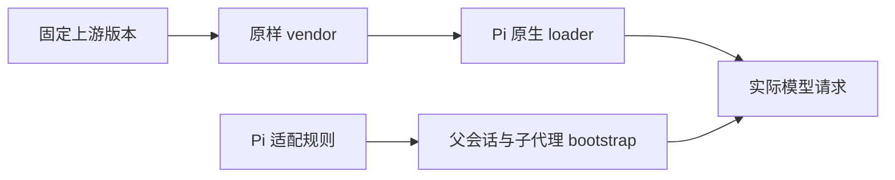

# Pi pstack 原样上游迁移与问题修复计划

> 实施状态（本轮）：原样 vendor、单一 Pi 适配、双 SDK 测试、旧目录与 vendor/bro 删除、上游 0.15.28 到 0.15.30 演练、失效进程 cwd 的 codemode 防护均已落地。实际运行中的 pi-web 需重启或 reload 后加载新扩展。

本版按用户最新目标重新规划，替代上一版保留整套手工改写 skills 的建议。这里将“像 dsh 一样只维护 dsh”理解为 Pi 也只维护自己的宿主适配层，上游 pstack 保持原样。上一版保存在 [历史计划](/tmp/pstack-dsh-replan-20261023/superseded-plan.md)。

目标有两个。使用者继续使用 Pi 的命令、持久模式和原生子代理，并得到可验证的问题修复。维护者以后更新上游时，只审查上游差异、维护 Pi 适配规则和运行验收，不再逐个合并几十份改写后的 SKILL.md。

当前交付仍是计划。生产目录、模型配置和运行中会话没有按此计划迁移。本轮新增的实验都在独立临时目录运行。

## 完成条件与范围

迁移完成必须同时满足以下条件。

1. `vendor/pstack/` 与固定上游 Git tree 一致，包含原始 skills、playbooks、references、脚本和许可。任何文件变化都由完整快照更新产生，不手工编辑 vendor。
2. Pi 只加载这一份上游正文。原来的手工改写目录 `skills/pstack/` 已删除，所有活动调用者已迁移，没有第二套长期兼容正文。
3. Pi 差异集中在一份宿主适配文档、少量装配代码、声明清单和必要的本地支持脚本。模型选择仍以原生 settings 为准。
4. 单次 `/skill:*`、`/pstack on`、子代理、恢复和重载均能取得适配规则。不能依赖父会话以前恰好读过某个文件。
5. 范围内所有已确认缺陷都有原触发路径的失败与修复后成功证据。未复现风险必须得到有针对性的验证或明确阻塞，不能统一写成“已修复各种问题”。
6. 在一个隔离副本中完成真实的上游版本更新演练。演练不需要编辑某个上游 skill 的正文来维持 Pi 功能。
7. 配置包搬到另一目录后可加载和升级。已有用户配置、凭据和未受管文件保持完整。

允许的实现范围包括本配置仓库的 pstack 装配、相关角色、prompts、检查器、打包和验证流程。对实际复现到 Pi 或 pi-web 宿主的缺陷，使用对应版本的源码建立修复，不直接修改全局 node_modules。无需改动的 Pi 功能继续保留。

普通任务不自动变成 goal、定时任务、对外发布或消息操作。配置里已经存在的模型选择不因本计划被替换。同一工作目录只保留一个写入者。

throughput checkpoint: n/a, planning and read-only investigation。

## 新增证据改变了什么

上一轮的比较结果仍保留在 [调研报告](/tmp/pstack-dsh-research-20261023/report.json)。本轮增加了直接决定迁移结构的隔离实验。

| 实验 | 实际观察 | 对计划的影响 |
| --- | --- | --- |
| 直接加载上游目录。 | Pi loader 能加载原始 skills，相对 references 仍可读取。 | 不生成改写后的技能树。 |
| 同时加载两个 bro。 | 未过滤时出现 collision，上游 bro 覆盖了所选的 vendor/bro。 | 必须显式处理公共命令的名称冲突。 |
| 使用 Pi 原生路径过滤。 | 排除上游 `bro/SKILL.md` 后 diagnostics 为空，既有 bro 保持可用。 | 直接挂载 vendor，省掉链接安装器。 |
| 请求前加入适配提示。 | how、sharpen、setup-pstack 的原始正文保持完整，适配标记同时进入有效提示词。 | 宿主钩子负责 bootstrap，不给每个文件插入提示。 |
| 删除独立进程的当前目录。 | codemode 返回与本会话相同的 `uv_cwd ENOENT`，恢复有效目录后同一调用成功。 | 将真实宿主的进程目录问题列为单独修复项。 |
| 对比 SDK 安装。 | 命令行 Pi 为 1.4.0，pi-web 安装内嵌 SDK 为 1.2.0。 | 验证必须识别实际宿主，不能只依赖 PATH 中的 pi。 |

加载和 bootstrap 实验已分别在 1.4.0 与 1.2.0 上通过。证据为 [加载实验](/tmp/pstack-dsh-replan-20261023/overlay-probe-web.json)、[bootstrap 实验](/tmp/pstack-dsh-replan-20261023/bootstrap-probe-web.json) 与 [SDK 清单](/tmp/pstack-dsh-replan-20261023/sdk-installations.json)。实验使用真实 loader 和 SDK 请求装配，在请求发送前截获，没有模型 API 调用。

[codemode 实验](/tmp/pstack-dsh-replan-20261023/codemode-cwd-probe-web.json) 使用安装包的实际执行器。这证明了可复现机制，没有证明当前宿主进程的 cwd 是谁删除的，也没有修复运行中的会话。

本轮还补跑全部 Python 测试，8 项通过，其中包含打包检查。结果见 [Python 日志](/tmp/pstack-dsh-replan-20261023/python-all-tests.log)。上一轮的 23 项 Node 测试和静态检查通过记录仍有效，但不代表已经验证了新迁移结构。

## 目标结构

建议保留本配置仓库，采用原样快照和 Pi 适配层。运行时不依赖本机 `~/workspace/dsh-pstack` 的位置。

```text
vendor/pstack/                         固定上游完整快照，不手改。
adapters/pstack/pi.md                  唯一的 Pi 宿主适配规则。
adapters/pstack/policy.json            名称排除、支持范围、合同检查入口。
adapters/pstack/upstream.lock.json     生成的 commit、tree、版本与文件完整性记录。
adapters/pstack/bootstrap.ts           父会话与 pstack 子代理共用的提示装配。
adapters/pstack/scripts/find-sessions.py
skills/pi-native/                     Pi 专有的少量辅助技能。
extensions/pstack-mode.ts              继续拥有模式开关和分支状态。
agents/                               Pi 原生角色与工具限制。
scripts/pstack-sync.mjs                固定版本同步与更新报告。
scripts/check-enabled-skills.sh        通用资源检查和适配层检查入口。
```

这是建议新增或迁移后的路径，不表示文件已经存在。

Pi 原生 `settings.skills` 直接挂载 `./vendor/pstack/skills`，再按适配清单应用精确排除。已经用真实 loader 验证的相对过滤语法是 `-./vendor/pstack/skills/bro/SKILL.md`。配置路径在安装目录重新解析，不保存作者机器的绝对路径。

用户已决定删除 `vendor/bro`。公共 `bro` 命令由原样上游提供，仓库不再保留第二个同名来源。

首批保持当前已支持能力的范围。其它上游技能和 playbook 完整保存在 vendor，支持状态由 policy 明确说明。新增执行型入口在通过适配和行为验收前不自动对外承诺可用。纯内容更新无需维护另一份正文。

control-cli、control-ui、create-skill 和 deslop 作为少量 Pi 本地能力迁入 `skills/pi-native/`。保留许可和来源。它们不作为 pstack 同名正文的替代品。recall 只保留必要的 Pi 会话选择程序，不再保留一份改写后的 recall SKILL.md。



## 适配层负责什么

适配层解释宿主差异。原生 Pi 和 pi-subagents 继续负责启动、异步完成、恢复、取消、worktree 和 artifact 生命周期。

| 上游概念 | Pi 装配与规则 | 必须验证的行为 |
| --- | --- | --- |
| Task、subagent_type、后台执行。 | 映射到已确认的原生角色与一个顶层 async workflow。 | 依赖步骤等待真实终态，不把启动回执当结果，不新增调度器。 |
| Cursor 模型 slug 和角色预算。 | 读取原生 agent 的有效模型与 thinking，使用实际 provider/id。 | 不写虚构模型名，不保存第二份角色模型配置。 |
| readonly 与评审。 | 使用受限角色，检查最终工具集。 | write、edit、bash 及其它变更工具不可调用，输出由原生 output 路由。 |
| 相对路径与 `.cursor` 路径。 | 上游相对路径保持 skill baseDir，项目技能目标映射到 `.pi/skills/`。 | cwd 与 skill 目录不同时仍可读取 references 和脚本。 |
| setup-pstack。 | 合并用户已请求的原生 settings 字段。 | 不生成 `.mdc`，不覆盖无关设置，不强制重新询问已知偏好。 |
| recall 与 why 的资料来源。 | Pi 工作区会话选择程序、Git、GitHub 和仓库资料。 | 不扫描无关项目，不把未连接的外部服务当可用资料。 |
| `/loop` 与长任务。 | 普通持续工作按现有任务完成条件执行。只有明确请求 goal 才使用 pi-goal。 | 开启模式、持续时间和“继续”都不能自行创建目标或轮询。 |
| 并行写入与清理。 | 使用 managed worktree 和原生 reviewed cleanup。 | 不自动 stash 用户修改，不执行上游脚本删除未知 worktree。 |
| 提交、PR、发布和外部消息。 | 使用当前任务已经授予的权限。 | skill 文本和被跳过的步骤不能扩大外部操作范围。 |
| 不支持的外部集成。 | 明确显示 unsupported 或 blocked。 | 依赖其产物的后续步骤不伪造 URL、key 或成功状态。 |

`policy.json` 只保存可检查的声明。以技能名、playbook 名或合同 ID 为索引，记录可加载状态、限制理由和验证入口。`upstream.lock.json` 只保存机器生成的来源与完整性数据。实际模型、运行状态和 child catalog 仍由原生系统拥有。

这里不再维护逐技能 adopt、adapt、retain 的正文合并清单。旧 `upstream.json` 中有价值的来源和限制理由迁入这两类记录，其余成为历史资料。

### bootstrap 的边界

父会话通过现有扩展在请求前加入一个短的 `pstack_adapter` section。它说明何时读取 `pi.md`，并明确 Pi 宿主规则优先。`/pstack on` 额外启用原始 poteto-mode 内容。`off` 关闭工作流，不启动任务，也不改变模型或工具。

pstack 子代理显式装配同一 bootstrap。实现时使用当前 package 支持的 child-only extension 机制，不依赖继承全局 AGENTS 或父代理已读内容。只读角色也必须具备读取适配资料的能力。

对原生 reviewer 的复用先验证装配能力。若需要局部独立角色，使用小型 `pstack-reviewer` 定义并读取原始评审 rubric，不复制一整套评审正文。其模型仍按现有 reviewer 的有效路由解析，避免再增加一份模型配置。

完整适配说明不需要出现在每个普通聊天请求里。短 bootstrap 可以常驻，但只在使用 pstack 时触发。缺少必要 bootstrap 或能力时不得把流程标成成功。

### 跟随上游行为的选择

本版选择跟随上游 sharpen 语义。迁移后 `/skill:sharpen` 只改写提示词并返回，不自动执行任务。该变化写入迁移说明并增加代表性验收，不再为保留旧 Pi 行为维护第二份 sharpen 正文。

Pi 的授权、会话范围、原生工具和证据要求是适配规则，继续覆盖相应宿主差异。上游修改这些相关文本时，审查的是适配合同是否仍成立，不逐个改写 skill。

## 问题清单与关闭方式

问题按证据分级。配置事实不自动算 bug，迁移风险也不能冒充已经复现的现有故障。

| 项目 | 当前状态 | 修复或验证动作 | 关闭条件 |
| --- | --- | --- | --- |
| 三个 prompt 仍要求旧 chain，两个引用缺失的 planner。 | 已确认，原生 validate 已拒绝 planner。 | 在最终切换单元改为现行 workflow，并加入入口检查。 | 旧 fixture 失败，新入口通过，未知角色仍被拒绝。 |
| codemode 返回 uv_cwd ENOENT。 | 本会话观察到，两个 SDK 可隔离复现同一机制。 | 定位真实宿主进程 cwd、启动方式与目录删除者，在正确组件修复。 | 原触发路径与实际宿主均恢复，同类错误可诊断且没有工具调用。 |
| CLI 和 pi-web 的 SDK 安装版本不同。 | 环境事实，影响验证覆盖。 | 查明实际加载版本，固定支持组合或在源码依赖中对齐。 | 验收记录对应实际宿主，没有只测另一个 SDK 的盲区。 |
| 原样 skills 没有自动取得 Pi adapter。 | 迁移风险，离线请求实验已展示差异。 | 装配父会话和子代理 bootstrap。 | 单次调用、模式、恢复与 fresh child 均可取得规则。 |
| 上游 bro 与既有 bro 冲突。 | 已在隔离 loader 复现。 | 使用原生路径过滤，检查名称所有者。 | 无 collision，公共 bro 保持原来源。 |
| scout 声明含 bash 和 write。 | 已确认能力，不等于已经发生越界写入。 | pstack 只读探索使用局部受限角色。 | 最终工具调用被限制，哨兵文件不变。 |
| 两个默认角色属于同一 GPT 家族。 | 合法配置事实。 | 在明确要求跨家族时检查实际席位，不改用户默认值。 | 同家族不会被报告成跨家族评审。 |
| recall 程序依赖旧目录层级。 | 已从实现确认，移动后需要改路径。 | 迁移本地会话选择程序并更新模块引用。 | 跨目录、缺失会话库、空结果和工作区隔离测试通过。 |
| 打包器不会自动清除目标端旧 pstack 文件。 | 从复制策略推断的升级风险。 | 引入受管旧文件清单和升级 fixture，先预检再切换。 | 干净旧安装可升级，自定义旧文件触发冲突，用户文件不被删除。 |
| 静态检查漏掉 prompt 与宿主装配问题。 | 旧模板问题与全绿基线同时存在。 | 将公开入口、装配和旧路径检查纳入统一验证。 | 故意破坏的 fixture 均失败，正常配置通过。 |
| pstack review 与 advisor 自动 review 可能同时运行。 | 集成风险，尚未证明故障。 | 在适配测试中区分两者的身份、证据和 usage。 | 不把 advisor 的只读咨询结果冒充独立子代理面板。 |
| 原来的模式、分支与 reload 行为。 | 当前测试通过，应保留。 | 迁移路径并继续跑原行为测试。 | 无重复注入、无失效工具句柄复用、恢复后的状态正确。 |

已知入口证据见 [运行观察](/tmp/pstack-dsh-research-20261023/runtime-observations.md)。现有 [recall 程序](../adapters/pstack/scripts/find-sessions.py) 与 [打包器](../scripts/pack-config.py) 是迁移时必须处理的实际调用者。

执行中若发现同范围的新缺陷，加入清单并先复现。范围外问题只有在阻塞上述完成条件时才纳入修复。范围内的高影响缺陷未关闭时，不宣布迁移完成。

## 分阶段执行

默认一个实施者，集成也由该实施者负责。本计划没有要求启动子代理。若后续明确要求并行或独立审查，使用一个原生 async workflow，写入隔离 worktree，在依赖点检查真实结果和 diff。

| 单元 | 前置 | 负责人 | 主要结果 |
| --- | --- | --- | --- |
| R0 固定宿主和缺陷基线。 | 无。 | 配置维护者。 | 当前配置保护、宿主版本清单和失败 fixture。 |
| M1 建立原样上游与适配层。 | R0。 | 同一维护者。 | 不加载到生产的候选 vendor、adapter、policy 和同步工具。 |
| M2 接通宿主并修复合同。 | M1。 | 同一维护者。 | bootstrap、原生角色、会话程序与行为验收。 |
| M3 整组切换并删除旧实现。 | M2。 | 同一集成者。 | 所有调用者、检查器和打包同步迁移，旧改写目录消失。 |
| B1 修复实际 codemode 与宿主问题。 | R0，可与 M1 至 M3 独立推进。 | 实际组件的修复者。 | 已实现失效 cwd 的启动恢复并验证 codemode；运行中宿主仍须 reload 或重启。 |
| V1 完整验收和上游更新演练。 | M3 与 B1。 | 同一集成者。 | 问题关闭、真实入口通过、低维护成本得到一次升级证据。 |

M1 与 M2 可以在独立候选副本内短暂不满足旧路径测试。实际配置保持可用，直到整组切换。不得为了保持每个中间状态而增加长期双实现。

### R0 固定宿主和缺陷基线

编辑边界是验证工具、fixture、问题记录和必要的宿主识别。先记录 `settings.json` 与其它用户修改的摘要和哈希，不自动 stash 或提交。原始 Pi checkout 目前已有用户的 settings 修改和 `.artifacts/`。

现有 SDK 测试通过 PATH 发现 pi。将其改为可显式选择 SDK root，并在保留默认便利性的同时，验证实际 Web 宿主。建议使用项目专用变量 `PSTACK_TEST_SDK_ROOT`。变量值必须解析为真实 package，结果记录版本和路径。

先建立旧 chain、缺失 planner、bro 冲突、缺少 bootstrap 和失效 cwd 的失败用例。保留已通过的模式、reload、历史和打包测试。尚未证明的问题先记录为待复现，不为了数量制造修复。

当前可复跑的实验如下。它们是临时设计实验，不是可交付的产品实现。

```bash
node /tmp/pstack-dsh-replan-20261023/overlay-probe.mjs
node /tmp/pstack-dsh-replan-20261023/bootstrap-probe.mjs
node /tmp/pstack-dsh-replan-20261023/codemode-cwd-probe.mjs
```

以上三个命令均接受一个可选参数指定 SDK root。本轮实际 Web 安装路径为 `/home/linuxbrew/.linuxbrew/lib/node_modules/@agegr/pi-web/node_modules/@earendil-works/pi-coding-agent`。

R0 的完成条件是基线可复跑、实际宿主身份已记录、确认缺陷有失败证据。证据保存到 `/tmp/pi-pstack-overlay/R0/`。

### M1 建立原样上游与适配层

编辑边界为新增 `vendor/pstack/`、`adapters/pstack/` 和 `scripts/pstack-sync.mjs`。旧 skill 目录暂时不动，候选资源不加入生产加载路径。

从上游 Git 对象导出完整 pstack tree。首批固定 commit 为 `eb4db2b55b2b7dec3d9282754cddf0a56bf4ff10`，对应 v0.15.30。现有 `/tmp/pstack-upstream-research-20261019` 已具有该对象。不要把经过 dsh 安装器裁剪的副本当成完整 Git tree。

同步工具只管理自己的 vendor 范围和生成 lock。同步前拒绝覆盖被手改的 vendor。先在 staging 目录生成候选，检查完整性与适配覆盖，再替换受管快照。失败时原活动版本保持完整。重复同步相同 ref 必须没有额外差异。

适配覆盖检查包括上游 TERMS、实际模型家族、脚本入口、公开命令和直接或间接路由到的 skill 与 playbook。TERMS 只是一项静态检查，不证明授权、只读或异步行为正确。新增执行型内容需要明确支持结论，不能以“词都认识”自动通过。

推荐命令接口如下。它们在本单元实现，随后成为维护入口。

```bash
node scripts/pstack-sync.mjs --from /tmp/pstack-upstream-research-20261019 --ref eb4db2b55b2b7dec3d9282754cddf0a56bf4ff10 --dry-run
node adapters/pstack/check.mjs
node --test tests/pstack-overlay.test.mjs
```

完成条件是完整快照可验证、候选 loader 无 diagnostics、名称排除有效、同步两次无漂移，且原始正文没有补丁。证据保存到 `/tmp/pi-pstack-overlay/M1/`。

### M2 接通宿主并修复合同

编辑边界为 bootstrap、模式扩展、相关 agent 定义、适配说明、本地支持程序和对应测试。所有路径由文件位置和配置根解析，不写 `/home/qliu` 到产品实现。

先为以下行为建立确定性的 SDK 用例，再接线。

- 原始 skill 正文与 Pi adapter 同时进入有效请求，正文保持原样。
- mode off 的单次 how、setup-pstack、sharpen 调用也能取得适配规则。
- mode on、off、分支切换、恢复、压缩和 reload 不重复注入，也不启动任务。迁移前开启模式的会话，在旧目录删除后仍能恢复并读取新来源。
- fresh 子代理在不继承全局上下文、关闭 ambient extensions 时仍取得所需 bootstrap。
- 只读角色最终不可调用变更工具，输出仍可由原生 artifact 路由保存。
- 模型与 thinking 从有效原生设置解析，错误路由明确失败，同家族组合不冒充跨家族。
- recall 的程序迁到适配层后仍只读取指定工作区，空结果与不可用会话库返回不同结果。
- 上游会写 `.cursor`、建循环、自动提交或清理工作树的路径，按 Pi 适配合同执行或明确阻塞。

若使用 child-only extension 时出现必需 provider 或注册错误，修复该装配，不临时放宽工具集。适配规则需要真实流程验证，不能仅通过提示字符串出现就宣布模型会遵守全部语义。

主要命令为本单元新增或迁移的行为测试。

```bash
node --test tests/pstack-bootstrap.test.mjs tests/pstack-readonly.test.mjs
node --test tests/pstack-mode.test.mjs tests/reload-runtime.test.mjs tests/pstack-recall.test.mjs
```

使用明确的 SDK root 重跑涉及宿主的测试。完成条件是上述确定性行为通过，并且缺失 bootstrap、权限或模型能力的用例确实失败。证据保存到 `/tmp/pi-pstack-overlay/M2/`。

### M3 整组切换并删除旧实现

负责人为集成者。编辑边界包括 settings 中的受管 skill 路径、prompts、检查器、打包器、帮助文档、agent 路径和所有旧目录调用者。

一次迁移完成以下内容。

1. 将当前公开入口迁到 vendor 原始正文与 Pi 本地能力。
2. 将三个旧 prompt 改为现行原生 workflow，不为兼容旧模板新增 planner。
3. 迁移 recall 支持脚本和四个 Pi 本地技能，更新所有调用方。
4. 删除 `skills/pstack/` 的手工改写正文，移除旧加载路径和逐文件正文合并流程。
5. 将活动文档、来源清单和检查器指向新结构。历史文档注明版本，不继续充当可执行入口。
6. 更新配置包内容和升级程序，确认目标安装不会留下旧的自动发现 skill。

不能靠增加一批同名技能再碰运气决定加载顺序。检查器要读取最终资源集合，验证每个公共名字的实际所有者。技能数量由选定上游、排除清单和本地能力推导，不继续散布固定 54 的断言。

配置安装先检查所有目标和冲突。只删除有旧受管清单且内容匹配的旧文件。遇到用户改过的旧文件或未知内容时，在切换前报告具体冲突。不要递归删除目标的整个 `skills/pstack` 来凑干净状态。

切换作为一个可回滚的迁移单元交付。安装时保持 Pi 空闲，整组完成后一次 reload。这里不承诺多文件系统写入具有事务原子性。失败时只恢复本次拥有的路径和配置字段，不覆盖用户无关修改。

打包验收必须覆盖首次安装、从旧结构升级、重复安装、作者路径不可用、已有目标 settings、失败的依赖安装，以及用户自定义旧文件。一个仅测试“能解压”的 fixture 不够。

```bash
./scripts/check-enabled-skills.sh
node --test tests/pstack-prompts.test.mjs tests/pstack-overlay.test.mjs
python3 -B -m unittest discover -s tests -p 'test_*.py' -v
```

完成条件是旧活动目录和调用者均消失、目标升级可复跑、公共命令无冲突、用户设置保持完整。证据保存到 `/tmp/pi-pstack-overlay/M3/`。

### B1 修复 codemode 与实际宿主问题

本单元从 R0 独立推进，不要求先完成正文迁移。

先记录实际 Pi 或 pi-web 进程及其加载的 SDK root，确认进程 cwd、Session cwd、仓库目录和临时 worktree 的关系。Linux 上从实际宿主的进程记录读取 cwd。进程身份必须来自宿主，不能猜一个与当前 shell 相同的进程。

随后在实际组件源码中找到丢失 cwd 或错误生命周期的生产者。修复长期宿主使用将被回收目录的问题，并让会话工作目录通过显式参数传给操作。不要在每次 codemode 前调用全局 `process.chdir(session.cwd)`，这会影响同一进程内其它会话。

CLI 与 Web 可以有不同安装版本，但支持范围必须清楚。优先在源码依赖与锁文件中对齐经过验证的组合。若仍需保留两个版本，就明确测试两个宿主，不能只靠命令行 `pi --version` 声称 Web 已验证。

不可直接手改全局 node_modules。需要上游修复时，准备对应版本的独立源码 checkout、回归测试和本地构建。不要为绕过问题新增第二个编码 CLI、关闭 codemode 或让所有工作长期退化为其它执行方式。

验收至少包含有效 cwd、宿主目录被回收、两个 Session 使用不同 cwd、运行中 reload 和明确的启动失败。修复后在实际 Web 和 CLI 入口分别执行无副作用脚本及一次只读工具调用，确认正常返回和工具结果。故障路径必须说明是否已经调用任何工具。

[codemode 临时复现程序](/tmp/pstack-dsh-replan-20261023/codemode-cwd-probe.mjs) 是现成触发器。实际生产者定位后，将它收敛为所属源码的回归用例。

已完成隔离回归与实际 codemode 执行。`extensions/stable-process-cwd.ts` 只在 `process.cwd()` 已经失效时回退到当前 Session 目录，避免常规请求的全局 chdir。实际运行中的宿主需要 `/reload` 或重启后加载该扩展；本轮未改动用户正在运行的服务。具体构建命令在定位所属源码后固定，当前不伪造尚未确认的 repository 命令。证据保存到 `/tmp/pi-pstack-overlay/B1/`。

### V1 完整验收和更新演练

先运行整合后的完整离线检查。

```bash
./scripts/check-enabled-skills.sh
node adapters/pstack/check.mjs
node --test tests/*.test.mjs
python3 -B -m unittest discover -s tests -p 'test_*.py' -v
git diff --check
```

再在隔离的实际 CLI 和 Web 会话验证公共命令、模式通知、重载和恢复。按更新后的 [.pi/skills/verify-pstack](../.pi/skills/verify-pstack/SKILL.md) 保留证据。不能切换当前用户会话的模式来替代隔离验收。

具有现有认证且获得相应委派范围后，运行一个只读调查、一个小型 bug fix、一个显式跨家族评审和一次 managed worktree 的结果整合。按真实结果报告模型、thinking、run ID、output reference、handoff 和验证命令。advisor 的咨询与原生子代理审查分别记录。

最后完成两项更新演练。

- 在候选副本中从固定 v0.15.28 更新到 v0.15.30。只改 vendor 快照、生成 lock 和确有必要的适配规则。sharpen 的行为变化应通过说明和验收体现，不产生 Pi 专用正文副本。
- 在 fixture 上加入未知宿主能力或新的执行型入口。同步检查必须失败并指出缺失项，原活动快照保持完整。不能只演练“没有任何变化”的成功路径。

完成后重新核对问题清单。所有范围内确认缺陷均关闭，未支持能力有准确状态，旧路径没有活动引用，vendor 完整性成立，安装包跨目录有效，上游更新无需逐文件修补。

若模型、工具、实际宿主或源码构建前提不可用，标记对应验收 blocked，保留已经通过部分。不把 blocked 当作迁移全部完成。证据保存到 `/tmp/pi-pstack-overlay/V1/`。

## 维护流程与成本边界

后续上游更新按固定顺序进行。

1. 在仓库外取得明确 ref，查看来源差异和脚本变化。
2. 同步候选快照，生成完整性记录和支持范围差异。
3. 运行适配覆盖、真实 loader 和相关行为检查。
4. 只在宿主能力或明确的 Pi 合同变化时修改适配层。
5. 验证整合结果后交付一次更新。

这减少了正文合并，不等于无需审查上游。上游指令仍可能新增外部操作、依赖或行为变化。新增执行型内容和脚本必须经过检查。

不新增自动更新守护进程、同步调度器或另一套模型 registry。完整的无人值守自动化、对外发布和额外平台集成不属于此次迁移的完成条件。

## 本轮选择、限制与下一步

本版已经选择原样 vendor、原生路径过滤和统一 Pi bootstrap。取消上一版继续维护几十份改写正文的路线。sharpen 默认跟随上游。现有用户模型选择保持不动。

本轮的三个实验都是 throwaway artifact。它们证明加载与提示装配的可行性，以及 cwd 故障机制，不证明整个新运行流程已经实现。原始计划与实验源码保存在 [本轮证据目录](/tmp/pstack-dsh-replan-20261023)。

下一轮执行从 R0 开始。先固定实际宿主、保护用户工作树，再建立失败 fixture。M1 至 M3 与 B1 在逻辑上可以独立推进，但默认由一个实施者串行完成。

这些原则改变了本版选择。

- [Redesign From First Principles](../vendor/pstack/skills/principle-redesign-from-first-principles/SKILL.md) 让原样上游成为目标结构的起点。
- [Laziness Protocol](../vendor/pstack/skills/principle-laziness-protocol/SKILL.md) 让直接路径过滤取代生成树和链接安装器。
- [Model the Domain](../vendor/pstack/skills/principle-model-the-domain/SKILL.md) 让来源完整性、支持策略和运行状态各有明确所有者。
- [Build the Lever](../vendor/pstack/skills/principle-build-the-lever/SKILL.md) 让加载、bootstrap 和 cwd 机制都有可复跑实验文件。
- [Outcome-Oriented Execution](../vendor/pstack/skills/principle-outcome-oriented-execution/SKILL.md) 让候选副本允许有界中间状态，最终只保留目标结构。
- [Migrate Callers Then Delete Legacy APIs](../vendor/pstack/skills/principle-migrate-callers-then-delete-legacy-apis/SKILL.md) 让所有调用者迁移和旧改写目录删除在同一单元完成。
- [Prove It Works](../vendor/pstack/skills/principle-prove-it-works/SKILL.md) 让实际宿主、模型执行和安装升级成为独立验收条件。

需留意。本轮没有独立模型审查，也没有开始生产迁移。codemode 的真实宿主故障仍待定位与修复。新版计划的决策继续记录在同一份 [decisions.tsv](/tmp/pstack-dsh-research-20261023/decisions.tsv)。
